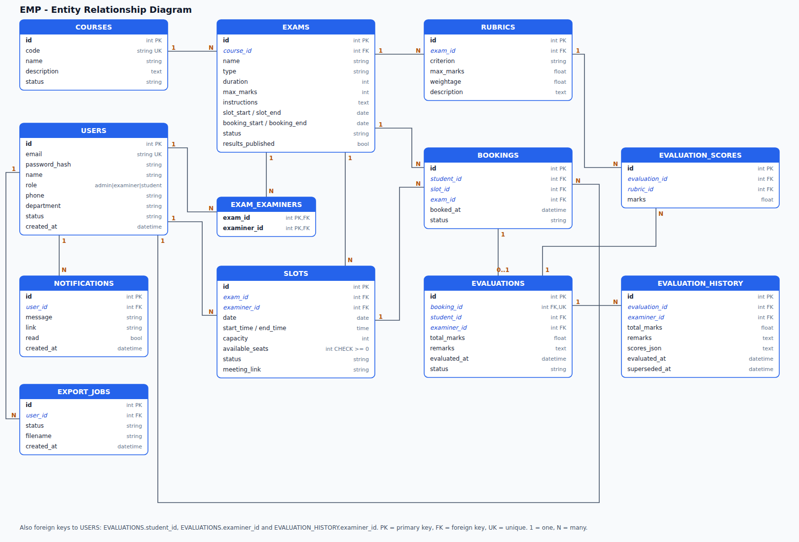

# App Dev Project Report

## 1. Student Details

- **Name:** Harshad Bharat Gangurde
- **Roll Number:** 23f2004217
- **Email:** 23f2004217@ds.study.iitm.ac.in
- **About Me:** I am a student of the IIT Madras BS Degree programme with an interest in web application development and data-driven technologies. I enjoy building practical applications that combine a clean user experience with a solid backend, and I built this project to practise full-stack development with Flask and Vue.

## 2. Project Details

**Project Title:** Examination Management Portal (EMP) - V2

**Problem Statement:**
Institutions run examinations (vivas, practicals, project demos, assessments) with spreadsheets and e-mail. The task is to design and build a web application where an **Admin** sets up courses, examinations, rubrics and examiners; **Examiners** publish availability slots and evaluate students against the rubric; and **Students** register, book a slot for an examination, and see their published results. The system must also run batch jobs (daily reminders, a monthly report, CSV export) and cache frequently read data in Redis.

**Approach:**
The application is a Flask REST API with a Vue 3 single-page front end, built in this order:

1. Modelled the domain first (users, courses, examinations, rubrics, slots, bookings, evaluations) with one `users` table and a `role` column (admin / examiner / student), so one login flow serves all three roles.
2. Built the Flask API as a set of Blueprint modules. Every endpoint is wrapped by a `roles(...)` decorator that checks a signed bearer token, and every input is validated on the server. Business rules (slot-creation and booking windows, one active booking per student per examination, slot capacity, an examiner can only evaluate students in their own slots, cancellation deadline) are enforced in the API, not only in the UI.
3. Prevented double-booking with a database `CHECK (available_seats >= 0)` and an atomic `UPDATE ... WHERE available_seats > 0`, plus a unique index on active bookings, so simultaneous requests cannot over-book a slot.
4. Built the Vue 3 front end (loaded from a CDN, no build step) as native ES modules with a small hand-written router, one page per task, styled with Bootstrap 5 and usable on both phone and desktop.
5. Added Redis caching (exam lists, rubrics, slot schedules; 60 to 300 second TTL, cleared on every write) and Celery jobs (a daily reminder, a monthly report on the 1st, and a student-triggered CSV export that raises an in-app alert when done). Everything falls back to in-memory behaviour if Redis is not running.
6. Wrote an end-to-end test suite (`unittest`, 30 tests) that exercises the API rules above.

## 3. AI/LLM Declaration

AI/LLM was **partially** used in this project. I used Claude Code (Anthropic) as an assistant for parts of the work: code suggestions for some Flask routes, models and Vue pages, restructuring the project into the required `frontend/` and `backend/` folder layout, performance clean-up (fewer database queries per request, compressed responses, removal of duplicate files and unused code), help with the Gmail e-mail set-up, and drafting this report. The design of the application, the business rules, and the review, running and testing of every feature were done by me. The extent of AI/LLM usage is partial and limited to code suggestions, clean-up and documentation.

## 4. Technologies and Frameworks Used

| Technology / Library | Purpose |
|---|---|
| Flask | Core backend web framework and REST API |
| Flask-SQLAlchemy / SQLAlchemy | Object-relational mapper for the database; tables are created from model code |
| SQLite | Local database (`emp.db`), created programmatically on first start |
| itsdangerous (bundled with Flask) | Signed, expiring bearer tokens for login; logout revokes a token through Redis |
| Werkzeug (bundled with Flask) | Secure password hashing |
| Jinja2 (bundled with Flask) | Renders only the single entry page (`index.html`); the UI itself is Vue |
| Vue 3 (CDN) | Single-page user interface with a small built-in router |
| Bootstrap 5 (CDN) | Responsive layout and styling for mobile and desktop |
| Chart.js (CDN) | Analytics charts: popular examinations, examiner workload, booking trends (falls back to plain SVG if the CDN is unreachable) |
| Redis (redis-py) | Caching, rate-limit counters and revoked-token list |
| Celery (+ kombu) | Batch jobs: daily reminder, monthly report, CSV export; Celery beat for the schedules |
| Python standard library | `smtplib` (Gmail e-mail), PDF generation for the scorecard and monthly report, `unittest` for tests |

No other frameworks or libraries are used.

## 5. Database Schema / ER Diagram

**Tables:**

- **users** - all accounts (id, email, password_hash, name, role, phone, department, status, created_at)
- **courses** - course catalogue (id, code, name, description, status)
- **exams** - examinations of a course, with the slot-creation and booking windows and a lifecycle status (id, course_id, name, type, duration, max_marks, instructions, slot_start, slot_end, booking_start, booking_end, status, results_published)
- **exam_examiners** - association table: examiners assigned to an examination (exam_id, examiner_id)
- **rubrics** - weighted marking criteria of an examination (id, exam_id, criterion, max_marks, weightage, description)
- **slots** - examiner availability (id, exam_id, examiner_id, date, start_time, end_time, capacity, available_seats, status, meeting_link)
- **bookings** - a student's booking of a slot (id, student_id, slot_id, exam_id, booked_at, status)
- **evaluations** - one evaluation per booking (id, booking_id, student_id, examiner_id, total_marks, remarks, evaluated_at, status)
- **evaluation_scores** - marks per rubric criterion (id, evaluation_id, rubric_id, marks)
- **evaluation_history** - earlier versions of an evaluation changed before results were published (id, evaluation_id, examiner_id, total_marks, remarks, scores_json, evaluated_at, superseded_at)
- **notifications** - in-app alerts (id, user_id, message, link, read, created_at)
- **export_jobs** - CSV export jobs run by Celery (id, user_id, status, filename, created_at)

**Relationships:**

- One-to-Many: Course to Exam; Exam to Rubric; Exam to Slot; Exam to Booking; Slot to Booking
- One-to-Many: User (student) to Booking; User (examiner) to Slot; User to Notification; User to ExportJob
- Many-to-Many: Exam and User (examiners) through `exam_examiners`
- One-to-One: Booking to Evaluation (unique `booking_id`)
- One-to-Many: Evaluation to EvaluationScore; Evaluation to EvaluationHistory; Rubric to EvaluationScore




## 6. API Resource Endpoints

All endpoints are under `/api` and, except register and login, need the header `Authorization: Bearer <token>`.

| Endpoint | Method | Description |
|---|---|---|
| `/api/auth/register` | POST | Student self-registration |
| `/api/auth/login` | POST | Authenticate (admin, examiner or student) and return a token |
| `/api/auth/logout` | POST | Revoke the current token |
| `/api/auth/me` | GET, PUT | Read or update the signed-in user's profile |
| `/api/courses` | GET, POST | List courses; create a course (admin) |
| `/api/courses/<id>` | PUT, DELETE | Update or delete a course (admin) |
| `/api/exams` | GET, POST | List examinations (cached); create one (admin) |
| `/api/exams/<id>` | GET, PUT, DELETE | Read, update or delete an examination |
| `/api/exams/<id>/examiners` | PUT | Assign examiners to an examination (admin) |
| `/api/exams/<id>/status` | POST | Move an examination along its lifecycle: Draft, Slot Creation, Booking Open, Closed, Completed |
| `/api/exams/<id>/publish` | POST | Publish results and notify students by e-mail and in-app alert |
| `/api/exams/<id>/rubrics` | GET, POST | List (cached) or add rubric criteria |
| `/api/rubrics/<id>` | PUT, DELETE | Update or delete a criterion |
| `/api/examiners` | GET, POST | List/search or create examiners (admin) |
| `/api/examiners/<id>` | PUT | Update, activate or deactivate an examiner |
| `/api/students` | GET | List/search students (admin) |
| `/api/students/<id>/status` | PUT | Activate or deactivate a student |
| `/api/slots` | GET, POST | List slots (students get the cached schedule of an exam); create a slot |
| `/api/slots/<id>` | PUT, DELETE | Update (admin: reschedule) or cancel a slot |
| `/api/slots/<id>/examiner` | PUT | Change the examiner of a slot (admin) |
| `/api/slots/<id>/bookings` | GET | Students booked in a slot |
| `/api/slots/<id>/complete` | POST | Mark a slot completed |
| `/api/bookings` | GET, POST | Booking history; book a slot (student) |
| `/api/bookings/<id>/cancel` | POST | Cancel a booking before the deadline (student) |
| `/api/bookings/<id>/reschedule` | PUT | Move a booking to another slot (admin) |
| `/api/bookings/<id>/evaluate` | POST | Submit rubric marks and remarks (examiner) |
| `/api/bookings/<id>/evaluation-history` | GET | Earlier versions of an evaluation (admin) |
| `/api/bookings/<id>/scorecard.pdf` | GET | Download the scorecard as a PDF (student, after publication) |
| `/api/results` | GET | Published results with feedback (student) |
| `/api/dashboard` | GET | Role-specific dashboard data |
| `/api/admin/charts` | GET | Popular examinations, examiner workload, booking trend |
| `/api/admin/search` | GET | Search students, examiners, examinations and bookings |
| `/api/admin/report` | GET | Monthly statistics |
| `/api/admin/report/pdf` | GET | Download the monthly report as a PDF |
| `/api/admin/report/send` | POST | E-mail the monthly report (with the PDF attached) |
| `/api/notifications` | GET | Latest in-app notifications |
| `/api/notifications/read` | POST | Mark all notifications as read |
| `/api/export/history` | POST | Start an asynchronous CSV export (Celery) |
| `/api/export/<id>` | GET | Poll an export job |
| `/api/export/<id>/download` | GET | Download the finished CSV |

**YAML API Definition File:** included separately in the submission ZIP as `openapi.yaml` (in the `backend` folder).

## 7. Architecture and Features

**Architecture Overview:**

```
frontend/
  index.html          single entry page
  public/             css/app.css, manifest.json, sw.js (add to desktop), icons/
  src/
    main.js           creates the Vue app
    App.js, router.js, api.js, state.js, format.js, pageMeta.js
    components/       shared components (Modal.js, ChartBox.js, PageBlocks.js)
    views/            one file per page (Login.js, AdminDash.js, StudentExams.js, ...)
backend/
  app.py              Flask application entry point and app factory
  config.py           settings (read from the environment and .env)
  routes/             Flask Blueprint modules: auth, courses, exams, rubrics, people,
                      slots, bookings, evaluation, dashboard, exports
  models/             SQLAlchemy models: user, course, exam, slot, evaluation, notification
  cache.py            Redis cache, rate limits, broker check
  celery_app.py, tasks.py   Celery app, beat schedule and the batch jobs
  services.py         e-mail, Google Chat webhook, PDF and HTML reports
  run.py, seed_data.py, check_services.py, tests/, openapi.yaml, requirements.txt
```

**Implemented Features:**

- Role-based login for Admin, Examiner and Student; student self-registration; secure password hashing; token revocation on logout; login rate limiting
- Admin: courses, examinations (with slot-creation and booking windows), weighted rubrics, examiners, students, all slots and bookings, rescheduling, global search, result publication
- Enforced examination lifecycle: Draft, Slot Creation, Booking Open, Closed, Completed
- Examiner: create and manage availability slots, evaluate students against the rubric, change marks until results are published (history is kept)
- Student: browse examinations and the rubric, book and cancel slots, see meeting links, view published results with feedback
- Clash and capacity checks that hold under simultaneous requests
- Analytics dashboards with Chart.js: popular examinations, examiner workload, 30-day booking trend
- Single responsive UI for mobile and desktop, built with Bootstrap, with an "add to desktop" (installable web app) manifest
- Frontend validation (HTML5 attributes and JavaScript) and backend validation on every API
- Redis caching of exam lists, rubrics and schedules, invalidated on every change
- Batch jobs with Celery: daily reminder for tomorrow's bookings, monthly report on the 1st, asynchronous CSV export with a completion alert

**Additional Features:**

- Downloadable examination scorecard (PDF)
- Monthly examination report as an HTML e-mail with the PDF attached, also downloadable
- E-mail and in-app notifications for slot booking, cancellation and result publication
- Daily reminder by e-mail and (optional) Google Chat
- Evaluation history and an audit log of sensitive actions
- Automated test suite (30 tests) and a one-command start-up script (`run.py`)

## 8. Video Presentation

**Drive Link:** https://drive.google.com/drive/folders/1VWgBPYp5pfomaveas6s2bQbZT1jEWXTH?usp=sharing

(Accessible to all with "View" permission.)
